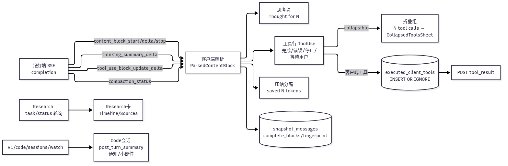
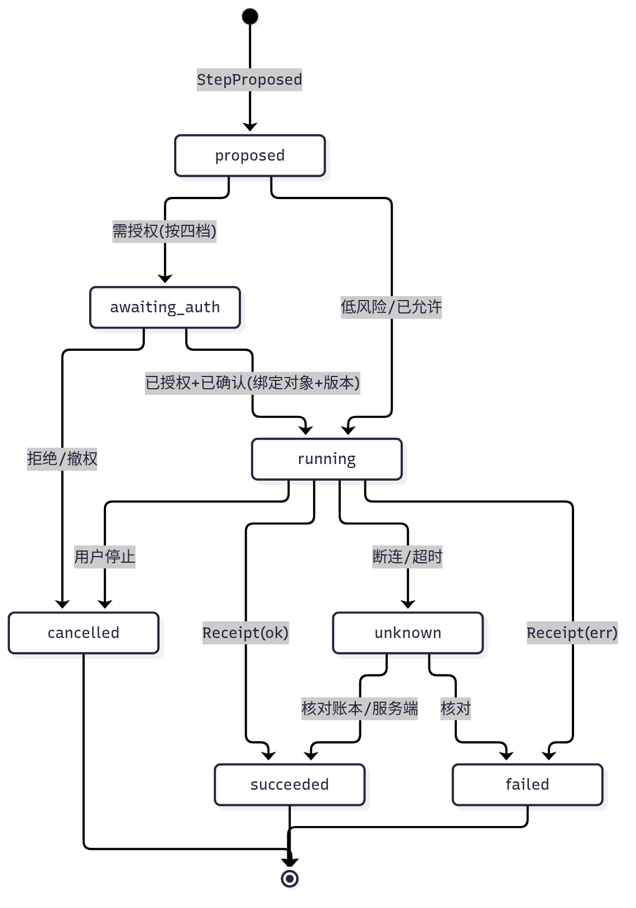

# Claude Android 1.261009.20 ·「执行摘要」专题（静态分析）

> 2026-10-13（Asia/Shanghai）｜只分析 base APK，规则与主报告相同｜分级：A=APK 内可复核；B=多条 A 推断；C=官方文档（标日期）；D=混淆类名、混合常量等线索。
> 本次沿用主报告的 jadx 输出：23,311 个类，162 个反编译错误。相关包都已反编译成功，所以没有重跑；没解析出来的部分写"未知"。

## 0. 定义与存在性
**执行摘要**：把一次或一组"思考 / 工具调用 / 子代理 / 研究 / 远程会话"执行过程，压缩成一个可扫读单元，包含状态、计数、耗时、结论，并能展开看明细或跳到产物。容易混淆的两类：
- **记忆摘要**（Memory summary）讲的是"关于用户的长期信息"，不算执行摘要，只作对照。
- **压缩摘要**是给模型用的上下文压缩。App 只显示"已压缩·节省 N token"这条回执，不显示摘要正文，按"边界摘要"处理。

| 候选 | 存在？ | 等级 | 关键证据 |
|---|---|---|---|
| 工具步骤摘要（单行） | 有 | A | 工具块字段 `message`、`display_content`、`integration_name`、`start/stop_timestamp`；文案 "Used a tool"、"Edited %1$d files" |
| 折叠组（多个工具/思考） | 有 | A | "Tool calls (%1$d)"、"%1$d tool calls"、"Used ^1 tools"；`CollapsedToolsSheetDestination`（Summary）；`content_block_stop.collapsible` |
| 思考块头部 | 有 | A | "Thought for %1$s"；思考块字段 `summaries[]`；流事件 `thinking_summary_delta`；"Claude's step-by-step reasoning isn't shown for this response" |
| 子代理摘要 | 有 | A | "Ran agent: %1$s (+%2$d tools)"；字段 `agentRunId`、`stepsCaption`、`stepsIcon` |
| 计划步骤进度 | 有 | A | "%1$d of %2$d steps done"、"Step %1$d of %2$d"、"Step failed/stopped"、"Show steps"；`StepActions` |
| Research 进度和摘要 | 有 | A | ResearchStatusResponse；`ResearchDetailsSheet`（Timeline/Sources）；完成后通知 |
| 压缩边界 | 有 | A | "Compacted conversation · saved %1$s tokens"；消息字段 `compaction_tokens`、`follows_compaction`；CompactionStatus |
| Claude Code 远程会话轮次摘要 | 有 | A | `PostTurnSummary`；会话字段 `post_turn_summary`、`task_summary`；`SdkToolUseSummaryEvent`；`SdkResultEvent` |
| 编辑和发现摘要卡 | 有 | A | "%1$d files changed"、"+%d lines"、"%1$d findings"；开关 `ccr_turn_edits_card`、`ccr_report_findings_card` |
| 通知、小部件汇总 | 部分有 | A | "%1$d waiting on you · %2$d finished"；`v1/code/notifications/summary`（unseen_count）；`NotificationDigestCounts{waiting, finished}`。小部件只看到会话列表和用量刷新，没看到"运行摘要"小部件，按未知处理 |
| "完成"标题 | 部分有 | A/D | 只见 "Completed"、"Completed task"、"Step %1$d completed"；没找到独立的"运行完成"标题组件 |

**歧义说明**：
- 带 "agent"、"subagent"、"Background agent" 字样的条目基本都属于 Claude Code 远程会话（sessions/code 包）。
- 普通聊天里只有工具调用、思考、Research 三类摘要。
- 两者在下面各节分开写，不混用。

## 1. UI 层
1. **组件和视图模型**（A，字段名来自序列化或 Compose 状态，未混淆）：
   - 工具行的视图模型（x0o）有这些字段：`toolUseId`、`toolName`、`toolKind`、`messageText`/`messageSubText`、`inputSummaryKind`/`inputSummaryContent`、`outputDisplayContent`、`isComplete`、`isError`、`isStopped`、`isWaitingForUser`、`isOutputTruncated`、`fileDiff`、`reviewFindings`、`todoList`、`savedFiles`、`resultImages`、`codeArtifactLink`、`stepActions`、`stepsAgentRunId`/`stepsCaption`/`stepsIcon`、`memorySummary`、`isMemoryWriteAck`。
   - 另一个渲染模型（zx3）有：`title`、`titleSource`、`state`、`inputSummary`、`isTruncated`。
2. **状态**：
   - UI 层四个布尔量：完成、错误、已停止、等待用户。四个都为假即"运行中"。（B）
   - 没有显式的"未知"态。重连时用会话级文案代替："Can't retry while reconnecting. The session is unchanged."、"Reconnecting… Claude is still responding in the background"。（A）
3. **折叠和展开**：
   - 服务端在 `content_block_stop` 里下发 `collapsible`、`disposition`、`summary_pending`。（A）
   - 客户端据此把连续的工具和思考块并成折叠组，组头显示"N tool calls"，点开进入 `CollapsedToolsSheet`。（B）
   - 埋点名 `trackCollapsedNarrationViewed` 说明折叠里还收了"旁白"文本。（D）
   - 有功能开关 `hide_tool_chrome_in_chat`。（D）
4. **文案模板**：
   - 计数类："%1$d tool call(s)"、"Ran agent: %1$s (+%2$d tool[s])"、"Edited %1$d file(s)"、"%1$d lines added/removed"。
   - 耗时："Thought for %1$s"、"%1$d minutes so far"（Research）、"Elapsed"。
   - 进度："%1$d of %2$d steps done"。
   - 汇总："%1$d working"、"%1$d waiting on you · %2$d finished"。
   - 完整列表见 evidence/01。
5. **图标和来源**：
   - 工具行显示 `integration_icon_url`/`icon_name`。（A）
   - Research 摘要显示 `top_icon_urls`、`top_source_domains`、`total_sources`。（A）
6. **排序**：按内容块的 `index` 顺序（A）；`content_block_retract(from_index)` 可以撤回已显示的块（A）。
7. **从摘要跳到明细或产物**：
   - 工具行可跳 `codeArtifactLink`、`presentedAttachmentIds`、`attachedResultBlockId`。（A）
   - Research 进 Timeline/Sources 底表。（A）
   - Code 步骤显示 "Step detail"，加载不到时提示 "Open the session in Code to see it"。（A）

## 2. 接口层
1. **普通聊天的流**（A，字符串级；"如何组合"是 B）：
   - 事件类型：`message_start`、`content_block_start`、`content_block_delta`、`content_block_stop`、`message_delta`、`message_stop`、`ping`、`error`，以及扩展的 `content_block_retract`、`compaction_status`。
   - delta 类型：`text_delta`、`input_json_delta`、`thinking_delta`、`thinking_summary_delta`、`tool_use_block_update_delta`、`citation_start_delta`/`citation_end_delta`、`flag_delta`、`bell_delta`、`voice_note_delta`。
2. **内容块**：
   - 类型：`text`、`thinking`、`redacted_thinking`、`tool_use`、`tool_result`、`image`、`flag`、`voice_note`、`bell`。
   - tool_use 字段：`name`、`input`、`input_incomplete`、`message`、`display_content`、`integration_name`/`integration_icon_url`、`icon_name`、`approval_key`/`approval_options`、`is_mcp_app`、`hidden_in_chat`、`memory_op_kind`、`tool_origin`、`start_timestamp`/`stop_timestamp`、`flags`。
   - tool_result 在 tool_use 的基础上多了 `tool_use_id`、`content`、`is_error`、`structured_content`、`meta`。
   - thinking 字段：`thinking`、`summaries[]`、`start/stop_timestamp`、`flags`。
3. **消息级字段**：`stop_reason`、`stop_display_text`、`compaction_tokens`、`follows_compaction`、`follows_context_clear`、`is_complete`、`is_retryable`、`failure_kind`、`superseded_message_id`、`was_dropped`、`parent_message_id`。
   - stop_reason 取值：end_turn、tool_use、pause_turn、max_tokens、stop_sequence、refusal、user_canceled、tool_use_limit、compaction、model_context_window_exceeded、conversation_length_limit、prompt_injection_risk、error。（A；混在同一个常量表里，取值本身按 B）
4. **普通聊天的接口路径**（A）：
   - `…/chat_conversations/{chat}/completion`、`/retry_completion`
   - `/tool_result`，请求体 RecordToolResultRequest：tool_use_id、content、is_error
   - `/tool_approval`，请求体：tool_use_id、is_approved、approval_key、approval_option
   - Research：`…/task/{task_id}/status`、`/stop`
5. **Research 状态响应**（A）：
   - ResearchStatusResponse：status、research_headline、started_at、finished_at、total_sources、top_source_domains、top_icon_urls、agent_summaries[]、error。
   - AgentSummary：description、total_sources、top_icon_urls、started_at、completed_at。
   - 状态取值线索（D，常量混杂）：planning、initiating_agents、searching、creating_artifact、completed、failed、cancelled、timed_out、client_timeout。
6. **Claude Code 会话**（A，只属于 Code）：
   - 接口：`v1/code/sessions`、`v1/code/sessions/watch`（SSE）、`v1/code/notifications`、`/summary`、`/mark_seen`、`v1/code/channels/{id}/remote-control-sessions/{sid}/me/decision`。
   - 会话对象字段：status、status_bucket、worker_status、connection_status、post_turn_summary、task_summary、last_event_at、unread。
   - PostTurnSummary：status_category、status_detail、is_noteworthy、recent_action、needs_action、description、artifact_urls。
   - SdkToolUseSummaryEvent：summary、preceding_tool_use_ids、parent_tool_use_id。
   - SdkResultEvent：subtype、result、is_error、num_turns、duration_ms、terminal_reason、isReplay。
   - SdkTaskPatch：status、description、error、is_backgrounded。
   - SdkTaskUsage：total_tokens、tool_uses、duration_ms。
   - SdkCompactMetadata：pre_tokens、post_tokens。
   - 另有 `compact_boundary` 事件。

## 3. 后台层（只写客户端能证明的部分）
- **谁生成摘要**：
  - 会话的 post_turn_summary/task_summary、Research 的 headline/agent_summaries、thinking 的 summaries 都由服务端下发。（A：都是响应字段；"服务端用模型生成"无法证明→未知）
  - 客户端只做三件事：组合计数文案（"N tool calls"）、算耗时（本地思考模型有 `endTimestampSynthesized`，即缺失时自己补结束时间）、做折叠分组。（B）
  - `summary_pending` 说明摘要可能晚于块结束才到。（B）
- **传输方式**：
  - 聊天走 SSE，由 `MessageSseService` 前台服务维持，可在后台继续接收。manifest 里不导出，foregroundServiceType=0x82，即 mediaPlayback + microphone，具体用途未知。（A）
  - Research 靠轮询 task/status。（B，依据：有 status 接口，没看到 Research 专用流）
  - Code 走 `sessions/watch` SSE，推送用 FCM。（A）
- **通知和 Worker**（A）：
  - CCRPermissionActionWorker：通知栏上直接批准或拒绝 Code 的工具请求。
  - SessionReplyActionWorker：从通知直接回复。
  - HubPermissionActionWorker。
  - 小部件：WidgetChatListRefreshWorker、UsageWidgetRefreshWorker、CodeShortcutsWidget。
  - 文案："Notifying you when Claude finished responding in the background / has finished researching / finished working on your code"。
- **服务端压缩**：
  - C：docs.anthropic.com/en/build-with-claude/compaction（访问 2026-10-13）：类型 compact_20260112，触发阈值 ≥50K tokens，compaction 块之前的内容被丢弃。
  - App 内服务端如何实现：未知。

## 4. 数据结构
- **Room 表**（A）：
  - `executed_client_tools(account_id, conversation_id, tool_use_id, executed_at)`，主键是前三项，写入用 INSERT OR IGNORE。用途：客户端工具执行账本，配合 `/tool_result` 回传（B）。
  - `snapshot_headers(…, leaf_message_id, updated_at, newest_message_at, project_id, facts BLOB, oldest_known_message_id)`
  - `snapshot_messages(…, message_id, parent_message_id, fingerprint, complete_blocks, body BLOB)`
- **complete_blocks 的关系**（B）：
  - 快照只缓存已经完成的块，执行摘要（折叠组、工具行）在恢复时从 body 重放，不单独存表。
  - fingerprint 用来增量比对；本地没有"摘要表"。
- **执行状态没有落地持久化**：工具行的完成、错误、停止标志是从块重新算出来的（B）。只有客户端工具的执行事实写进了账本。
- 序列化类和字段见 evidence/02、03；接口见 05；枚举线索见 06；表结构和查询见 07。

## 5. Muyon 映射：执行摘要设计

已定约束：
1. 账本强制：本地防重复和回执账本是 Rust core 的硬性要求。
2. 生成式卡片不能触发副作用。
3. 授权四档：每次询问 / 允许读 / 允许低风险 / 全部允许，"全部允许"只限个人账号。

**Rust core 数据模型**：
- `ExecRun{run_id, conversation_id, kind(chat_turn|research|agent|remote), status, started_at, ended_at, counts{steps, tools, edits, sources}, summary_text?, summary_source(client|server|model), summary_pending}`
- `ExecStep{step_id, run_id, parent_step_id?, seq, tool_name, exec_location(local|cloud|third_party), auth_tier_applied, target_ref{object_id, version}, title, input_summary, status(proposed|awaiting_auth|running|succeeded|failed|cancelled|unknown), collapsible, started_at, ended_at, receipt_id?}`
- `Receipt{receipt_id, action_id(唯一), step_id, outcome, server_ref?, executed_at, verified_at?}`
- 账本表：`action_ledger(account_id, action_id PK, step_id, executed_at, receipt_id)`，写入用 INSERT OR IGNORE。
- 摘要只是派生视图：可以从 ExecStep 和 Receipt 重新计算，不作为权威数据。

**事件契约**（Rust core 推给 UI，单调递增 seq，可重放）：
- RunStarted、StepProposed、StepAuthRequired、StepAuthorized、StepStarted、StepProgress、StepFinished(receipt)、StepUnknown、StepVerified、RunSummaryUpdated(summary_pending=false)、RunFinished、ContextCompacted{pre_tokens, post_tokens}、Retracted{from_seq}。

**UI 规格**（Compose / Electron+React 共用）：
- 单步行：图标 + 标题 + 输入摘要 + 状态徽标 + 执行位置标签。
- 连续可折叠步骤并成一组，组头为"N 个动作 · M 个文件 · 用时 t"，点开进底表或侧栏看明细。
- 有副作用的步骤必须显示回执号，并能跳到产物或对象的对应版本。
- 卡片或摘要上的按钮只能"查看明细、复制、发起新请求"，**不能直接执行**。
- 压缩用一条分隔线显示"已压缩·节省 N token"。

**映射到 book1/book2**：
- book1：C3 执行、C4 回执（账本）、C5 未知结果核对（StepUnknown → StepVerified）。
- book2：R01–R08 会话（步骤行和折叠组）、Q01–Q06（确认和核对）、T01–T03（工具状态文案）、S01–S05（四档授权在步骤上的体现）、W01（产物链接）、D01（导出时只带摘要，敏感输入按用途裁剪）。

## 6. 九态验收
| 状态 | 验收 |
|---|---|
| 正常 | 组头的计数、耗时和明细一致；回执号可跳转 |
| 空态 | 没有工具调用时不显示折叠组；Research 没有来源时显示"0 来源" |
| 错误 | 失败步骤在组头单独计数，展开后显示原因，可重试（经授权） |
| 离线 | 运行中的步骤标"后台继续 / 待同步"，不显示成"失败" |
| 取消 | 显示"已停止 · 已完成 k/n"，已完成的步骤各自有回执 |
| 撤权 | 撤权后，待授权或排队的步骤转为"已取消（撤权）"，后续不能执行 |
| 旧结果 | 摘要标注所依据的版本；对象更新后旧摘要标"已过期" |
| 重复点击 | 同一 action_id 只执行一次，再点返回原回执；账本是唯一事实 |
| 恢复 | 重启后由事件 seq 和账本重建摘要；"未知"步骤先核对再显示结论 |

## 7. 未覆盖
- 没有动态验证，"服务端如何生成摘要"未知。
- 枚举取值来自混合常量表，只能当线索（D）。
- 没找到"运行摘要"小部件。
- MessageSseService 的服务类型用途未知。
