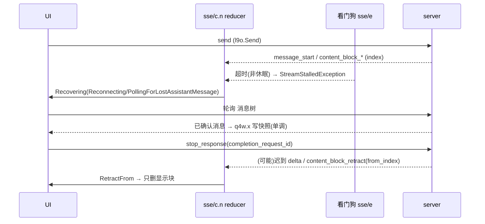

# RECOVERY-TRACE-03 · Claude Android 1.261009.20

> 只做静态分析。样本：base APK，sha256 `9807d321…786122a`，证书 SHA-256 `305a1e8a…18b64a0`（Play 签名形态，中等置信）。缺少 abi/density split。
> 工具：jadx 1.5.3（162 个类反编译失败，已用 apktool 2.7.0 smali 补足）。
> 标签只用四种：**包内直接证据 / 官方说明 / 推断 / 未知**。证据文件在 `evidence/RC-CL-*.txt`。鉴权相关结论见 AUTH-TRACE-02 的 CL-01…06，此处只引用，不再复述。
> 安全说明：Claude manifest 的 `com.google.android.geo.API_KEY` meta-data 里有一个 Google Maps key。本报告只记录它的位置，不收录它的值。

## 1. 事件模型：session / message / turn / tool call / block

App 里有**两条彼此独立**的事件通道。

### A. 聊天 SSE（claude.ai 对话）

**包内直接证据**（RC-CL-01）：
- 事件类型构成一个并集（`zyw`）：`message_start`、`content_block_start`、`content_block_delta`、`content_block_stop`、`content_block_retract`、`message_delta`、`message_stop`、`message_limit`、`ping`、`error`。
- 各事件携带的字段：
  - `message_start` 带 `message` 和 `discarded_parent_message_uuid`。
  - 块事件只带 `index`。`content_block_stop` 另带 `stop_timestamp` 和 `disposition`。
  - `content_block_retract` 带 `from_index`。
- 定位方式：消息靠 `message.uuid` 和 parent 链定位，块靠 `index` 定位。

**包内直接证据**：事件中**没有 event_id、seq、cursor 或 generation 字段**。上面的并集里没有这几个字段，所以原生 SSE 的 `id:` 不会被消费。

**官方说明**（Anthropic Streaming 文档，docs.claude.com/en/docs/build-with-claude/streaming，2026-10-13）：公开 API 的事件结构与上面一致，同样没有序号。文档还说明 tool_use 块和 thinking 块"cannot be partially recovered"。`content_block_retract` 不在公开文档里，属于 App 私有事件。

**处理重复、乱序和缺口的函数**（包内直接证据，RC-CL-02/03）：
- 主 reducer 是 `com.anthropic.claude.conversation.sse.c.n`，共 2581 条指令。
  - 收到 `message_start` 时清空本轮的块映射（niw.j/k/l）。
  - 块事件按 index 写入映射。
- 侧缓冲 `e5l` 有一个**代际计数 c**：每遇到一次 `message_start` 就自增，retract 只作用于当前代。
- 链路不按序号去重。乱序和缺口不在流内修补，改由**"停滞看门狗 → 轮询完整消息"**整体替换（见场景 2）。
- **推断**：这条流依赖 TCP 的有序性，单条流内不存在乱序问题；跨连接的重复由"轮询/读取已确认消息"兜底，而不是靠 seq。

### B. 远程 Code 会话（CCR / sessions）

**包内直接证据**（RC-CL-08）：
- `lvu.B` 解析的 SSE 类型有：`client_event`、`ephemeral_event`、`session_update`、`delivery_update`、`catch_up_truncated`。
- `client_event`（jyw）带 `event_id` 和 **`sequence_num`**。当 `sequence_num` 缺失时，用 SSE id 拼出 `durable-seq-N` 作为回退。
- 去重函数 `ujw.h`：
  - 若 `1 ≤ seq ≤ l`（l 为已接收的最大 seq），**直接丢弃**。
  - 客户端自己的回声（source = "client"）只推进 l，不发射。
  - 其他事件先发射，再执行 `l = max(l, seq)`。
  - 比 l 小的事件**不缓冲、不重排**。
- 缺口修复函数 `ujw.c` 处理 `catch_up_truncated(from_sequence_num, at_sequence_num)`，见场景 6。

## 2. 快照（conversation snapshots）

### 存储位置与表结构（包内直接证据，RC-CL-05/06）

- 数据库文件为 `acc_<account>_org_<org>_conversation_snapshots.db`，按账户和组织隔离。
- 共三张表：
  - `snapshot_headers(leaf_message_id, updated_at, newest_message_at, facts, oldest_known_message_id)`
  - `snapshot_messages(message_id, parent_message_id, fingerprint, complete_blocks, body)`
  - `executed_client_tools`

### 写链：complete_blocks 与 fingerprint 如何落盘（包内直接证据）

调用顺序为：q4w.x → eka.f → t4w.d → t4w.e → eka.x → t4w.b → eka.w。逐步如下：

1. **`q4w.x` 入口门控**，满足任一条件就直接返回，不写快照：
   - `eka.s()` 为真，即该会话已被"遗忘"；
   - 会话元数据为 null，或 `sga.a` 为真（`sga.a` 即 isTemporary，临时会话）。
2. **读取现有头并确定叶节点**：
   - 读取现有 header（ika）；
   - `t4w.c` 检查叶节点存在；
   - `t4w.a` 跳过 pending 消息（`sjl.i`），沿链找到**第一条服务端已确认的祖先**。pending 消息不进入快照。
3. **`eka.f` 批量读取指纹**：每批 500 条，读出 `(message_id → fingerprint, complete_blocks)`。
4. **`t4w.d` 校验分支可达根**：
   - 分支到不了根时记日志 "conversation snapshot branch does not reach a root"，放弃本次写入。
   - 截断点指向一条不存在的消息时，记日志 "cut names a message that is not stored"。
5. **`t4w.e` 归约（核心）**：
   - 消息未被服务端确认时抛出 "only a message the server has confirmed is cached"。
   - `fingerprint` 取序列化后消息的哈希（`co4.M0()`）。**指纹不变则返回 null，不写这一行**。
   - `complete_blocks` 的取值：
     - 消息已完成（`ho4.v()`）时，等于全部块数；
     - 否则，等于**从头开始、连续已完成的块数**（逐块检查 `e().k()`）。
   - 只有满足以下任一条件才写入：没有旧行、消息已完成、新的 complete_blocks ≥ 旧值。
   - → **包内直接证据**：已完成块数单调不回退，旧快照不会把较新的数据覆盖回去。
6. **写入**：先用 `eka.x` 写消息行，再用 `t4w.b` 构造头、`eka.w` 写头。两次写入**分属两个事务**（`po1.S`；jka.i 先走 kv9 case 4 写消息，再走 case 3 写头）。
   - **推断**：头里的 `leaf_message_id` 起到"提交指针"的作用。消息已写、头未写时崩溃，读路径仍从旧叶开始回溯，只会多出孤立的消息行，不会读到半个分支。

### 读路径（包内直接证据，RC-CL-06）

- `eka.a` 从叶节点沿 parent 链回溯；缺少某条消息或出现环时返回 null，即视为没有可用快照。
- `eka.b` 解码时遇到 `CachedMessageCodec$StaleRow`（编码版本过期）判为失败；`t4w.f` 对 StaleRow 同样返回 null。
- 加载来源的枚举值为 `initial_network`、`initial_cache`、`resume_refresh`。

### 快照与流谁先、版本是否一致

- **推断**（依据：加载来源枚举和状态机里的 `Loading`）：先读缓存（initial_cache）尽快展示，再请求网络（initial_network / resume_refresh）获取权威树。具体的调度先后没有完整追到 → 细节**未知**。
- **包内直接证据**：快照里**没有任何流游标**。它的版本标识是 `leaf_message_id` 加上各消息的 `fingerprint`，与 SSE 不共享版本号。
- 快照只是"已确认消息的显示缓存"。它不表示生成仍在进行，也不保存工具执行事实；执行事实存放在 `executed_client_tools`，见 AUTH-TRACE-02 CL-03。

## 3. 重连从哪里接续、cursor 失效、全量重拉

### 聊天 SSE（包内直接证据，RC-CL-03）

- **没有断点续传**。看门狗 `sse/e.a` 以 interval/4 为周期休眠检查：
  - 如果墙钟间隔大于 2×interval，判定为设备休眠，不触发；
  - 否则抛出 `StreamStalledException`："The reply stream received nothing from the server, not even a ping, for N ms, so it was closed and **the reply is polled for**"。
- 恢复状态（`p8r`）共四种：`RetryingSend(attempt, isBusyContainer)`、`Reconnecting`、`PollingForLostAssistantMessage`、`GaveUp(exit, kind)`。
- 恢复发送（resumed send）后，如果回复的 `message_start` 的 parent 与保存的 human 消息不匹配，就抛出 `SavedMessageNotAnsweredException`："the resumed send's reply did not answer its saved message"。
- 时间常量（jhw）：重试退避 [… 3 s, 6 s]，b = 5 s，d = 30 s，c = 240 s。

### 发送记录 l9o

- 字段包括 `takenByServer`、`serverMayHaveReceivedMessage`、`serverHumanId`、`serverLeafMoved`、`restored`。
- **推断**：这些字段区分"服务端确认已接收"与"可能已接收"，用来避免重发时生成重复的 human 消息。具体的重发判定分支没有完整追到 → **未知**。

### 全量重拉是否会重复计数、重跑工具、或用旧内容覆盖新输入

- **不会重复计数**（包内直接证据）：轮询拿到的是整条消息，靠 uuid 和 parent 链整体替换，没有增量累加。
- **不会让旧内容覆盖新数据**（包内直接证据）：快照写入受 fingerprint 和 complete_blocks 单调约束。
- **不会重跑工具**：客户端工具在执行前由 `executed_client_tools` 认领（AUTH-TRACE-02 CL-03）。
- **草稿**：会不会被覆盖 → **未知**（草稿存储没有追踪）。

### 远程会话（包内直接证据，RC-CL-08）

- 远程会话有三种接续方式：
  - `v1/code/sessions/watch?resume_token=…`；
  - `v1/code/sessions/{id}/events?cursor=…&sort_order=desc`；
  - `v1/sessions/{id}/events?before_id/after_id/anchor_to_latest`。
- WebSocket 订阅地址带 `replay=false`：`v1/sessions/ws/{id}/subscribe?…&replay=false`。
- 日志会记录是 "resume from scratch" 还是 "resume from token"，结束原因分为 ended_clean、receive_timeout、dropped、terminal。

## 4. Stop

- **包内直接证据**（RC-CL-04）：
  - Stop 接口为 `POST organizations/{org}/chat_conversations/{chat}/stop_response`，请求体是 `StopResponseRequest(completion_request_id)`。
  - 远程 Code 会话另有 `task/{id}/stop`。
- Stop 记录 `m9o` 的字段：

  ```
  Stop(target, targetsTurn, requestedAt, requestedAtElapsedMs, version, targetWasOpen,
       awaited, serverTurnEndedSinceRequest, isDeliveryOverdue, state)
  ```

  其中 state 取 `Dispatched` 或另一种状态 k9o。

**结论 1：三种状态有区分**
- **包内直接证据**：App 分别记录了：
  - "已请求"：requestedAt；
  - "已送达"：Dispatched，以及超时标记 isDeliveryOverdue；
  - "服务端回合已结束"：serverTurnEndedSinceRequest。
- UI 状态 `Stopping(openedAt, stopRequest)` 与 `AwaitedStop` 是两个独立的状态。
- **未知**：外部副作用是否发生。客户端没有"外部效果未知"这个专门状态；服务端是否真正中止也没有回执字段，只能从"回合结束"间接得知。

**结论 2：Stop 之后旧流仍会发布内容**
- **推断**：在服务端回合结束之前，流会继续被消费，所以 `Stopping` 期间到达的 delta 仍会显示。
- 分析事件里的 `abandonedByStopAt`、`stoppedBeforeContent`、`supersededAt` 用来记录这类竞态。

**结论 3：content_block_retract 只删显示片段**
- **包内直接证据**（RC-CL-02）：retract 只删除 reducer 内存中 `index ≥ from_index` 的块映射和侧缓冲（当前代的待定 tool_use 与文本），并发出 `RetractFrom(block=…)`。
- 处理路径上没有写 `executed_client_tools` 或快照表。
- → 它删除的是**显示/流内片段，不是已持久化的执行事实**。服务端怎么处理被撤回的块 → **未知**。

**其他**：没有回复在进行时点 Stop，会记日志 "Stop tapped with no response in flight"。

## 5. 杀进程、登出、切换会话、模式或权限变化

| 事件 | 待审批 | 工具认领记录 | 草稿/快照 | 标签 |
|---|---|---|---|---|
| 断网 / 流断开 | 待审批的客户端 tool_use **保留 240 s**（"tool approval kept through the drop"，`EndToolApprovalKeptThroughDrop`，deadline = now + jhw.c） | 不变 | 不变 | 包内直接证据 RC-CL-09 |
| 杀进程 | 内存中的审批状态丢失 | `executed_client_tools` 在 Room 中保留，可防止重跑 | 快照保留（只含已确认消息） | 前两项是推断；表结构是包内直接证据 |
| 登出 | — | AccountStorageCleaner 按账户前缀删除 DB、datastore 和 prefs | 一并删除 | 包内直接证据 RC-CL-06；"包括 executed_client_tools"是推断（该表没有单独的 DELETE 语句，随 DB 文件一起删除） |
| 切换会话 | 未追踪 | — | 快照按会话写入 | 未知 |
| 模式/权限变化 | 见 AUTH-TRACE-02 CL-05 | — | — | 引用 |

**执行边界**（不要混为一谈）：
- 手机端只执行**客户端工具**（client tools，按 tool_use_id 认领）。
- 远程 Code 会话的工具在云端或远端主机执行，手机只**显示**，并通过 control request（can_use_tool）给出审批。
- 云端执行器的实际状态 → **未知**。

## 6. 后台执行与任务存活

- **包内直接证据**（RC-CL-07）：`MessageSseService` 是普通 Service，**不是前台服务**，manifest 中没有 foregroundServiceType。
  - `onStartCommand` 直接返回 2（START_NOT_STICKY），方法体内没有任何工作。
  - 由 u37 引用计数管理：计数加一时调用 `startService`，减到 0 时调用 `stopService`。
- **推断**：它的作用是在有流时提升进程优先级。生成发生在服务端，手机只消费事件；进程被杀后由服务端继续或终止该回合，客户端重启后通过轮询或快照看到结果。
- 推送通知与任务存活之间的关系 → **未知**（没有追踪 FCM payload）。

## 7. 恢复时间线（6 个场景）

1. **正常恢复（重进会话）**：
   - 读取快照 `eka.a`，从叶节点回溯；若遇到 StaleRow 或断链，视为没有缓存。（包内直接证据）
   - 先显示缓存（initial_cache）。（推断）
   - 再从网络拉取树（initial_network / resume_refresh）。（推断）
   - 由 `q4w.x` 写回，满足单调规则。（包内直接证据）
2. **断线**：
   - 若设备并未休眠，超过 interval 没有任何字节（连 ping 都没有）时，抛出 StreamStalled 并关闭流。
   - 进入 `Recovering(Reconnecting / PollingForLostAssistantMessage)`，通过轮询取整条消息。
   - 待审批的工具保留 240 s。
   - （包内直接证据）
3. **取消竞态**：
   - 依次记录 Stop 已请求、Dispatched、可能的 isDeliveryOverdue。
   - 服务端回合结束后置 `serverTurnEndedSinceRequest`；在此之前到达的 delta 仍会显示。（推断）
4. **迟到结果**：
   - 回复的 parent 与保存的消息不符时，抛出 `SavedMessageNotAnsweredException`。（包内直接证据）
   - 被 retract 的块按 index 从显示中移除。（包内直接证据）
   - 远程会话中，seq ≤ l 的事件直接丢弃。（包内直接证据）
5. **进程重启**：
   - MessageSseService 返回 NOT_STICKY，不会被系统重启。（包内直接证据）
   - 重启后读快照，并轮询网络。（推断）
   - `executed_client_tools` 防止工具重跑。（AUTH-TRACE-02 CL-03）
6. **游标失效**（远程会话 `catch_up_truncated`，包内直接证据 RC-CL-08 `ujw.c`）：
   - `at_seq ≤ 0`：记日志 "malformed"，返回 TRUE。
   - 否则重新加载最新一页：
     - 加载出错：发射 `rwu`，返回 FALSE；
     - 页内最大 seq ≥ at_seq 且 ≥ l：整页替换，重新推导待处理的 control request（排除已解决的 id），记日志 "healed via latest-page reload"；
     - 其他情况：`l = max(l, at)`，记日志 "unfetchable transcript gap"，发射 `twu(true, false)`，即**明确告知存在缺口**，不假装已连续。



## 覆盖缺口

- base-only 样本，缺少 split APK。
- jadx 有 162 个类失败，已用 smali 补齐关键方法。
- 没有追踪：草稿存储、FCM、切换会话时的审批取消、服务端 stop 语义。
- 无动态验证。
