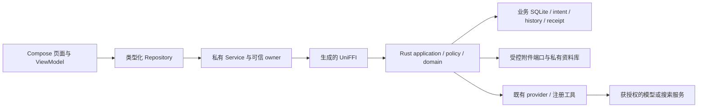
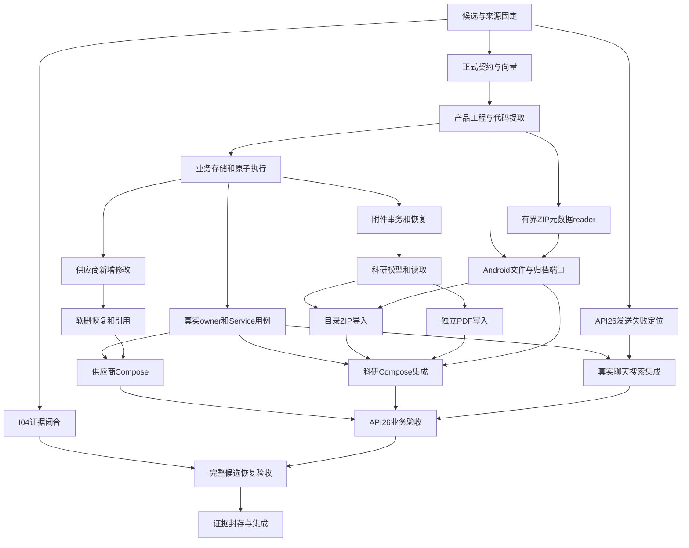

# Muyon Android 改造计划

状态：规划完成。独立架构复核 APPROVE / WATCH，独立质量审查 OKAY / APPROVE。业务实现未开始。

配套：[任务卡](muyon-android-refactor-tasks-20261020.md) · [测试与验收规格](muyon-android-refactor-tests-20261020.md) · [已确认清单](../../../../docs/tasks/MUYON-ANDROID-OPEN-WORK-20261020.md)。

## 1. 目标与停止条件

在 Rust/Compose Android 实现可实际使用的主链，并在 API26 模拟器验收：真实模型聊天、联网搜索、真实业务读取、供应商新增/修改/软删/撤销恢复，以及科研目录或 ZIP 导入和独立 PDF 添加。新数据、附件、任务和原始回执可以重启恢复；未知执行结果只查询，不自动重发。

不迁移历史 Flutter 数据；不要求 Windows/Electron、真机、正式签名发布、供应商合并、联系人/询价/报价模块全面迁移、论文 URL/DOI 检索或自动元数据提取。历史文件和原数据库不被覆盖。本次规划不增加付费额度，也不启动模型请求或业务写入。

完成条件是固定 source 的 API26 实际操作、SQLite/附件独立核对、恢复和真实 provider 证据都满足配套测试规格。只完成代码、离线 fixture、ABI 构建或 APK 打包不能关闭本计划。

## 2. 核查基线与复用清单

| 输入 | 可复用内容 | 不能冒称完成的部分 |
| --- | --- | --- |
| develop `0ab2c4f667681b9aacb017f8cd2eea6f576cf78e` | PR84 原生库/ABI/APK 规则及旧 Dart 业务规则和测试 | Rust/Compose 业务 CRUD 与科研写入 |
| PR86 `3f1be180bb009a91e659c113ba5b1916e5360332` | Rust/Android 组合候选与已通过门禁 | I04 缺证、未合入、真实业务 owner 和设备恢复 |
| PR88/89/91–99 | 供应商只读、Service ownership/admission、普通发送/连续会话/上下文、注册搜索工具 | 各 PR 不一定同 base；部分仅 compile SKIPPED；真实 owner/transport 仍须接入 |
| live canary `cebc6876c31651d5037dc54a10dfd1c72129dca0` | parser 修复 `84223bdd`、现有预算/请求/恢复约束、离线102 PASS | 两次真实 handoff accepted0；修复未装回设备；不是已合 PR |
| 原子业务实验 | intent、CAS、事务、原回执校验及进程故障测试 | 仅 `supplier.name`，schema 无真实 deleted；非 CRUD 产品实现 |
| Flutter supplier/research | 供应商字段与删除语义；研究快照导入和附件登记语义 | Dart 页面/实现不能作为 Rust/Android 已接线证据 |

源码依据：

- [既有目标架构](../../../../docs/design/redesign-v1.3.2-20261014/Muyon-Redesign-Plan-v1.3.2-2026-10-14.md#4-分层架构与双端职责) 第534–560行规定 Compose→Repository→UniFFI→Rust，Rust 决定业务事实；第578行明确宿主生命周期，第584行明确文件由受控端口读取。
- [供应商字段](../../../../packages/supplier_core/lib/src/entities.dart) 第13–45行；[校验](../../../../packages/supplier_core/lib/src/values.dart) 第43–67行；[软删/恢复/引用](../../../../packages/supplier_core/lib/src/store.dart) 第460–482、627–650行。
- [原子实验](../../../../experiments/redesign/device-deferred/atomic-business-lab/core/src/main.rs) 第66、85、145、153–185行；[实验边界](../../../../experiments/redesign/device-deferred/atomic-business-lab/CONTRACT.md) 第3–20行。
- [科研存储](../../../../packages/research_module/lib/src/core/store.dart) 第90–92行；[研究导入](../../../../packages/research_module/lib/src/core/exchange.dart) 第19–125、234–264、393–491行；[论文与来源绑定](../../../../packages/research_module/lib/src/core/research_skill.dart) 第157–171行。
- canary `experiments/redesign/android-compose-lab/app/src/main/kotlin/com/mightyoung/muyon/androidlab/agentipc/AgentRuntimeService.kt:209–217` 目前是 supplier read；`DurableServiceHostOwner.kt:67,417–421` 的库是 admission/reservation，不能当成业务数据库。

GitHub输入：[PR86](https://github.com/mightyoung/Muyon/pull/86)、[PR99](https://github.com/mightyoung/Muyon/pull/99)、[API26失败](https://github.com/mightyoung/Muyon/actions/runs/39279706227/job/118154923069)。后续开工必须由 P00 重新固定远端 source，不假设这些历史头永远不变。

## 3. 方案与取舍

原则：复用已有实现与证据；一份领域/权限事实源；业务提交和原回执一致；平台文件句柄不成为任意路径权限；从固定候选验证，不用不同分支的绿灯拼成整体通过。

主要驱动：已有多层分支必须收敛；供应商与科研都需要正式存储和授权；用户明确要求真实 API26 主链而非扩大实验。

| 方案 | 优点 | 代价与结论 |
| --- | --- | --- |
| A：持续扩充实验目录，直接将实验 APK 当产品入口 | 改动最少，可快速沿用脚本 | synthetic/default-off/实验 schema 容易混入验收；仅用于固定输入和复现，不能作为最终结构 |
| **B：建立明确产品入口，按模块提取既有代码和门禁** | 保留 provider/Service/恢复成果，隔离 fixture，与已有分层设计一致 | 需要一次提取和路径/绑定迁移证明；本计划采用 |
| C：重新实现整个 Rust/Android 栈及所有模块 | 目录可一次统一 | 丢失已审实现，新增重复授权与恢复逻辑、超出用户目标；不采用 |

建议产品落点（下列均为**计划新建**，不是声称仓库已有）：

```text
crates/muyon-core/                 # 单一Rust业务库，内部按职责分模块
  src/{contract,domain,application,policy,store,agent,platform}/
crates/muyon-android-ffi/          # 薄UniFFI导出；现有生成器/锁定版本
apps/muyon_android/               # 独立Compose应用工程
  app/src/main/.../{agentipc,platform,supplier,research,chat}/
docs/contracts/muyon-android/     # 本目标正式schema/状态/错误/一致性样例
tools/muyon_android/              # 候选构建、设备验收、结果验证入口
```

不为每个内部模块新建 crate，不新增第三方依赖。复用现有锁定依赖、绑定生成器和平台标准库；文件选择、ZIP 有界流读取等由 Android 适配器负责，Rust统一校验及提交。若已有依赖无法覆盖任务，先记录具体技术缺口和替代证据，不擅自安装或采用新库。

P02 只作行为保持的必要切片：建立产品身份、连接已有共享运行时，再按具体业务需要提取模块；不先全面搬迁实验目录。保留原实验命令、fixture和结果可追踪，可让实验成为共享实现的薄消费者。禁止复制后各自维护两套领域或权限规则。新 APK 独立应用/数据命名空间，不能自动读取或升级 Flutter 旧库。包名、DB标识、源码映射与实际构建命令作为 P02 交付物固定；D01/D02排障不以迁目录为前提。

## 4. 完整调用和存储边界



- UI 可以编辑草稿和表达确认，不能自行制造授权 capability、成功回执或直接写业务库。模型只提议业务操作；手动与模型路径共享同一类型化业务用例和权限校验，不要求手动操作先请求模型。
- 可信 owner 从当前 scope、真实用户确认和宿主配置形成绑定。业务库内的 `business_grant/authority_generation` 是**本地业务授权唯一事实源**；Service admission保留调度、外发/计费与reservation权限，不能重复充当本地业务授权库。二者按不可变admission ID关联，不能按reservation存在推导业务成功。
- 唯一Service CoreHost持有排他owner锁；业务grant发行/撤销、取消与业务commit进入同一Rust写队列。短业务事务内读取当前grant/generation并复验scope、host epoch、lease、plan/params、revision，再提交业务、history、intent和原回执。撤权以其业务DB事务COMMIT为线性化点：撤权先commit则动作拒绝；业务先commit则后来撤权不能抹掉事实。昂贵复制/解析在短事务外；不持Kotlin guard跨FFI回调，不同时持两个SQLite写事务。重启后新动作须取得当前epoch新授权，查询旧操作另验当前读权限。
- 业务receipt保存原admission ID、authority generation和参数绑定。admission结算在业务事务后独立进行；结算失败或丢回包保留待核对，按原intent返回业务事实，零重派发。外发/计费沿用既有Service权威guard，不把其合同偷偷迁进本地业务grant；跨库仍不承诺原子性。
- 业务写入：完整绑定 → 持久化 pending → 事务复验/CAS → 业务变化+history+终态+原回执一次提交 → 回包。取消只在执行状态允许时停止；commit后取消不抹除结果。重复点击、超时、重连复用原 intent，unknown 只查，不重发。
- 附件与 SQLite 不存在跨介质事务：**复制前**持久化导入intent和staging identity；`copying→pinned→committed/aborted`。有界复制和digest验证后持久pin保护blob，固化到内容寻址私有位置；复用既有blob须核长度/digest，不覆盖。论文/附件引用/原回执发布与释放发布pin在同业务事务完成；没有该COMMIT就没有成功论文。
- GC与发布使用同一DB生命周期状态：仅无引用、无发布pin、无reader lease/pin且所有相关intent已知终态的blob可原子标记`deleting`；标记后禁止新增发布/读取租约，再删文件和回收索引。**已持有reader**同样持pin直至关闭，不能只拒绝新读就删除旧读对象。pending/unknown pin不因超时失效；崩溃恢复仅在确认旧owner已死并核对引用/意图后解除可释放pin；重开后先恢复再允许GC，容量不足明确失败。lookup只读，GC/reconcile是显式维护动作。当前耐久承诺为真实进程终止/重开，不冒称断电耐久。
- Android 使用 picker 给出的 URI/流，附件发布后不依赖原 URI 继续可读。无自动 OCR/PDF元数据解析；只做约定格式/大小与完整性验证。预览、阅读用现有可用端口，不选新PDF引擎。

## 5. 必须固定的业务语义

P01仅冻结本次Android主链所需合同及Rust/Kotlin一致性向量，不宣称完整跨端M03或公共插件API已冻结，也不把Electron/全平台oracle增加为本次前置。此范围限定不减免本次全部required场景的实际执行；必需场景skip仍拒绝整体通过。

**供应商。** 保留八个存储字段 `name/aliases/address/categories/notes/merged_into/rating/rating_note`；名称必填200 codepoints、别名20×200、地址500、分类20×100、备注2000、评级备注500，rating沿用三枚举。新建 `merged_into=null`，普通编辑保留它，不新增供应商合并功能；联系人不作为供应商字段臆加。Rust统一规范化，Kotlin不以UTF16长度替代codepoint规则。完整字段变更绑定到同一意图和原回执。软删/恢复各产生新revision和独立回执；撤销通过restore用例，不回滚历史。引用策略复用旧语义；本次仅提供必要的引用索引与受控验证fixture，不全面移植报价/询价模块。

**科研。** 项目、论文/研究entry、source revision、document与附件索引分开建模。保留导入记录原始JSON和source identity；同id/rev重复保留并报告，已引用同修订变更拒绝，refresh只按已有规则处理未引用记录。目录与ZIP相同内容产生等价投影；同包重试按原导入intent查结果，不创建第二项目。新包使用新导入意图，不冒充重试。

独立PDF路径是新的类型化操作：`project_id`、用户填写的`title`（trim后非空，暂定上限500 codepoints）、一个私有PDF附件必需；作者列表、年份、DOI、URL、备注可选，仅按契约校验和保存，不发起联网补全。500为本计划的产品规则建议，须在 P01 固定并测试，不声称旧导入已有该约束。导入JSONL沿用原宽松title回退规则，不强行套用新手填表单。无项目时提供新建本地科研项目入口，不隐式导入历史工作区。

导入限制复用 `exchange.dart:19`：单文件30 MiB、总包150 MiB、10000文件；同时核声明与实际展开大小，拒绝穿越、绝对路径、盘符、NUL、符号链接和规范化重名。取消和失败不得产生可见的半论文或错误成功状态；最终详细规则与测试向量由 P01/R01 固定。

**文件/归档端口。** `FileSource`承载scope绑定的不可变snapshot ref、源类型、清单digest和有界读取lease；`ArchiveEntry`承载entry ordinal、raw name、规范路径、类型、压缩方法/flags、声明大小/CRC、offset范围与实际流计数。Rust从同一封存ZIP的原始字节独立解析元数据，不能相信适配器填的`isSymlink=false`。Android只按已批准entry读取/解压流，逐块计数、取消检查；Rust在发布前比对实际长度/digest、清单和原intent。目录URI同样冻结私有快照，不假造POSIX路径。

标准 `ZipEntry/ZipFile`没有公开UNIX mode/external attributes getter，`ZipInputStream`不读取中央目录，不能满足旧符号链接拒绝规则；此事实见[Android ZipEntry](https://developer.android.com/reference/java/util/zip/ZipEntry)、[Android ZipFile](https://developer.android.com/reference/java/util/zip/ZipFile)、[Java ZipInputStream](https://docs.oracle.com/en/java/javase/26/docs/api/java.base/java/util/zip/ZipInputStream.html)。Java文档只说明机制，API26行为另验。故新增A01作为必要技术前置，不能假设平台API自动保证。

A01实现无新依赖的**有界元数据reader，不重写解压引擎**：读取EOCD/中央目录/对应本地header，支持单卷ZIP32的STORED/DEFLATED，正确处理有/无data descriptor并核实际CRC/大小；固定名称编码、flags/extra白名单、creator host与类型属性，拒绝符号链接/特殊类型、offset越界/重叠/重复、CEN/LOC不一致及未支持组合。ZIP64、加密、多卷明确不支持并可见报错。依据[PKWARE格式规范](https://pkware.cachefly.net/webdocs/casestudies/APPNOTE.TXT)。自家研究导出round-trip是前置必过条件；若现有导出需要未支持组合或reader不能可靠通过审查，R02保持技术阻塞，记录替代方案，不削弱拒绝断言、不擅增依赖。

## 6. 依赖、并行与共同文件



图中前置表示可合入/可验收依赖；接口准备与展示逻辑可在契约冻结后先行，不能用假port结果关闭集成任务。I04缺证期间允许独立局部工作和专属测试，但包含它的整体候选不得宣称完成或借别名绕过限制。

执行建议采用有唯一集成人的多lane：核心/契约 owner、供应商 owner、科研 owner、Android owner、独立验证 owner。任务卡按文件划分；`contract`、store schema/migrations、Service owner、生成绑定、Gradle/CI由指定公共owner独占，业务lane只交具名接口请求。S01/S02同owner串行；R02/R03可在冻结接口后分别改不同子模块，不能并改科研schema。独立验证不改产品代码、不削弱作者断言。

公共文件交接：P01仅写schema/向量及contract源；P02负责首次工程/FFI/生成器接通，交付后P04成为FFI导出与生成Kotlin的唯一writer。P03唯一写业务schema/迁移；P04唯一写dispatcher/Service公共文件；集成人唯一写Manifest/Gradle/CI。交接以source hash、生成命令与owner表记录，不能出现两个lane同时“拥有”同一绑定文件。U02a负责文件能力先验，U02b负责业务UI，解除R02与原U02的隐含循环。

既有约定仍保留 LeaderB 集成 develop 的边界：在 P00 核对当时有效治理；本计划不授权其他lane自行合并。未来可由原生 `executor` 承担有界实现，`test-engineer`负责专属测试，`verifier`检查证据；只有正式启动team时使用team worker。当前不启动任何执行工作流。

## 7. 验证、风险与恢复

测试规格定义单元/合同、真实SQLite/进程、Android绑定/API26、真实provider四层。一般修改先跑受影响测试；合同与核心存储改动须跑相关业务回归；最终候选再跑完整适用门禁。编译失败不算行为RED；只给关键状态/事务/权限边界做有针对性的逆向变异，不能把每张表单都变成重复测试。

预演三类失败：

1. **分支提取后看似绿灯，实际加载旧.so。** P00记录source树和build id；P02绑定重生成、双ABI/APK内库digest、API26 runtime build id一致；不一致立即停止验收。
2. **文件复制完成但DB提交/回包丢失，重试产生半论文或双记录。** P05对复制、blob固化、DB提交前后、回包前的故障窗口做进程终止与独立DB/文件核对；原intent查询，不重新导入；清理只删无引用已确认孤儿。
3. **模型/Service失败被UI当成成功或再次派发。** P04/C01维持unknown与原身份，状态查询不产生新的模型请求/业务提交；计费unknown保留reservation；真实调用缺授权/预算时仅停止该实测，其他本地工作继续，最终状态明确未验收。

回退采用独立产品包/独立数据目录与可审查小PR；不删除旧Flutter库、不reset他人worktree、不改历史未知计费记录。共享模块提取有旧命令回归和来源映射，某切片失败可以回退自身提交，不能退掉他人已完成修复。schema不兼容拒绝打开，不自动清库；本次不要求历史迁移，也不能把新用户已写数据当可随意重建fixture。

## 8. 交付与评审状态

每卡交付代码/合同、针对性测试及命令、source/build/设备标识、原始日志位置、结果摘要和未测边界；只有满足任务完成标准才能标完成。所有卡初始为未开工，旧实验成果列作输入，不伪造本轮完成记录。

本计划采用 `plan` 直接规划；独立 Architect→Critic顺序审查记录见[架构审查](muyon-android-refactor-architect-review-20261020.md)与[质量审查](muyon-android-refactor-critic-review-20261020.md)。这是本地规划审查，不是 Ralplan runtime consensus，也不构成执行、付费或发布授权。计划审查通过后，本轮止于交付规划材料。

最终共21张任务卡、36项验收场景；依赖图与卡片无已发现循环，任务/测试引用及本地文档链接已核对。架构WATCH保留给A01 ZIP元数据reader的实现风险：独立代码审查、自家导出round-trip、拒绝样本和API26证据必须实际通过；规划批准不能关闭该技术门禁。
